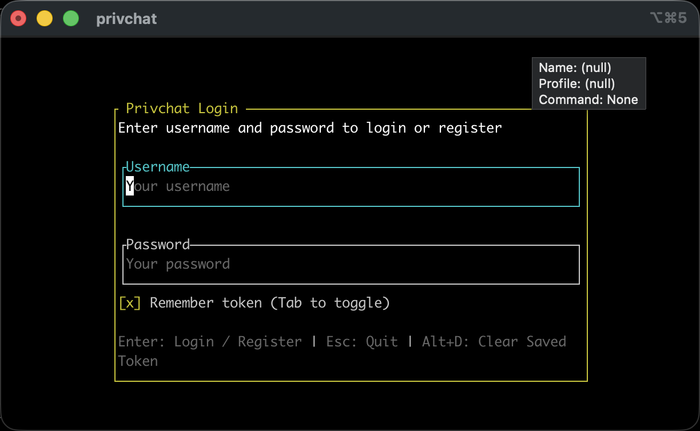

**Privchat CLI** 是 [Privchat](https://github.com/privchat) 协议的终端客户端（TUI），基于 Rust 与 [privchat-sdk](https://github.com/privchat/privchat-sdk)，使用 [Ratatui](https://ratatui.rs/) 构建界面。

面向习惯终端的用户：低内存占用、快速启动、键盘优先操作。

---

## 特性

### 账号与连接

- **登录 / 注册**：用户名 + 密码，首次可注册新账号，同一设备使用持久化 `device_id`。
- **连接**：支持 QUIC / TCP / WebSocket，连接状态与 Bootstrap 同步（好友、群组、会话、消息）自动完成。
- **Token 持久化**：可选「记住 Token」，使用系统钥匙串（Linux `libsecret` / macOS Keychain）或本地文件存储。

### 会话与消息

- **会话列表**：私聊、群组等会话统一展示，未读与最新消息预览。
- **消息列表**：历史消息滚动加载，本地与服务器消息一致。
- **发送消息**：支持文本与附件（内置 TUI 文件选择），发送状态与重试可见。

### TUI 体验

- **键盘优先**：`j`/`k` 移动、`g`/`G` 跳转、Enter 发送等，支持 Vim 风格导航。
- **Markdown**：消息内容支持 Markdown 与代码高亮（syntect）。
- **时间戳**：本地时区显示，可配置格式。
- **剪贴板**：一键复制消息内容或 ID。
- **桌面通知**：可选新消息系统通知。

### 技术栈

- **Rust**：内存安全、无 GC，低资源占用。
- **Clean Architecture**：Domain / Application / Infrastructure / Presentation 分层，便于维护与扩展。
- **privchat-sdk**：协议与同步、存储、事件由 SDK 统一处理，CLI 只做展示与交互。

---

## 安装与运行

### 从源码构建

**环境要求**：Rust 稳定版；部分平台需安装图片/系统依赖（如 Linux 需 `libchafa`、`dbus` 等）。

```bash
git clone https://github.com/privchat/privchat-cli
cd privchat-cli
cargo build --release
./target/release/privchat
```

**可选依赖（按平台）**：

- **Debian/Ubuntu:** `pkg-config libdbus-1-dev libchafa-dev libglib2.0-dev mold clang`
- **Fedora:** `pkgconf-pkg-config dbus-devel chafa-devel glib2-devel mold clang`
- **Arch:** `pkgconf chafa dbus glib2 mold clang`
- **macOS:** `brew install chafa`

### 配置与环境变量

| 变量 | 说明 | 默认 |
|------|------|------|
| `PRIVCHAT_SERVER_URL` | 服务器地址 | `quic://127.0.0.1:8082` |
| `PRIVCHAT_DATA_DIR` | 数据目录（用户 DB、KV、队列） | `io.privchat.privchat-cli` 对应 data_dir 或 `./data` |
| `PRIVCHAT_ASSETS_DIR` | 含 SQL 迁移的 assets 目录 | 当前目录下 `assets` 或 `privchat-cli/assets` |
| `PRIVCHAT_TOKEN` | 已有 Token 时可直接使用（可选） | — |

持久化配置使用应用 ID `io.privchat.privchat-cli` 对应目录（如 Linux 下 `~/.config/privchat-cli/config.toml`），未来 GUI 版可使用 `io.privchat.privchat` 独立目录。

---

## 使用说明

1. **启动**：运行 `privchat`，进入登录界面。
2. **登录 / 注册**：输入用户名与密码，Enter 提交；若账号不存在则走注册流程。
3. **勾选「记住 Token」**：下次启动可免输密码（Token 存本地或钥匙串）。
4. **主界面**：左侧会话列表，右侧消息列表，底部输入框；切换会话、读历史、发消息与附件。
5. **退出**：Esc 或命令退出；Token 若已保存，下次启动自动恢复登录。

**快捷操作**（以实际界面为准）：Enter 登录/发送，Esc 返回/退出，Alt+D 清除本地已存 Token 等。

---

## 路线图

- [x] 登录 / 注册（用户名 + 密码）
- [x] 会话列表与消息列表
- [x] 发送与接收消息、附件
- [x] Bootstrap 同步（好友 / 群组 / 会话 / 消息）
- [x] Token 持久化（文件 / 钥匙串）
- [x] Markdown 与代码高亮
- [x] 桌面通知
- [ ] XDG 配置目录与 `config.toml`
- [ ] 更多快捷键与可配置项

---

## 致谢

- [privchat-sdk](https://github.com/privchat/privchat-sdk)：协议与同步能力。
- [Oxicord](https://github.com/linuxmobile/oxicord)：提供 TUI 架构参考
- [Ratatui](https://ratatui.rs/)：TUI 框架。
- [TachyonFX](https://github.com/nicksrandall/tachyonfx)：启动与动效。
